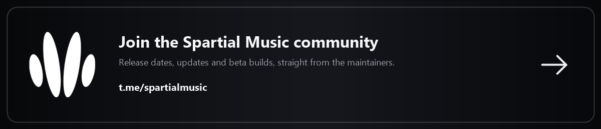
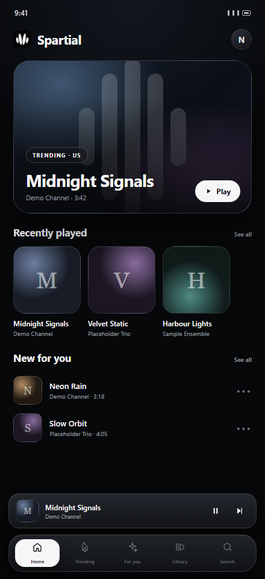
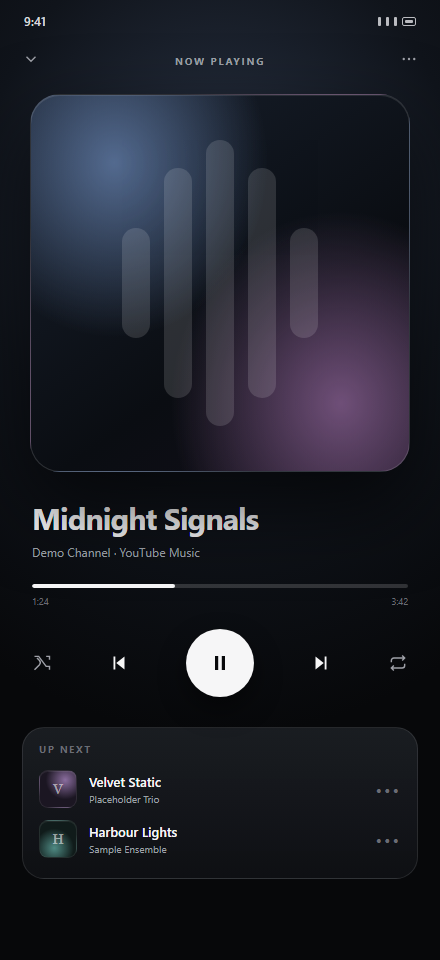
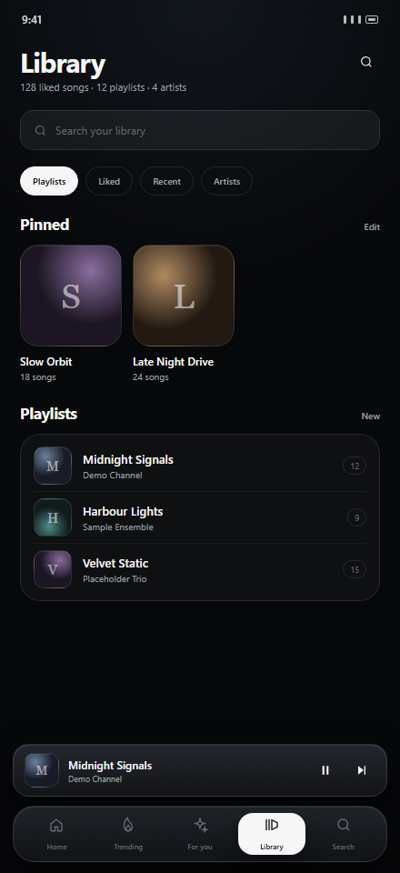

# Spartial Music

<p align="center">
  
</p>

<p align="center">
  <strong>A quiet home for your music.</strong><br>
  An open-source Android player with a near-black, glass-first interface.
</p>

<p align="center">
  <a href="https://t.me/spartialmusic">
    
  </a>
</p>

<p align="center">
  <a href="https://t.me/spartialmusic"><strong>Join the Telegram community →</strong></a><br>
  Release dates, updates and beta builds, straight from the maintainers.
</p>

**Like the app? [Star the repository](https://github.com/NullTrigger/Spartial-Music/stargazers) to support the project.**

<p align="center">
  
  
  
</p>

[](https://github.com/NullTrigger/Spartial-Music/stargazers) [](https://github.com/NullTrigger/Spartial-Music/releases) [](https://github.com/NullTrigger/Spartial-Music/releases/latest)

---

## Legal disclaimer

Spartial Music is a free, open-source, non-commercial project with no ads and no
analytics. It hosts no music or video. The optional YouTube Music source is
unofficial, may stop working at any time, and is used at your own risk and under
YouTube's terms. The app never downloads, caches or re-encodes YouTube media and
contains no PoToken or attestation bypass. It is not affiliated with or endorsed
by YouTube, Google, Jamendo or any other music service. Please support the
artists you listen to through official channels. Rights holders and others with
concerns can open an issue or contact the maintainer through the channels in
[SECURITY.md](SECURITY.md), and we will respond promptly. See also
[YOUTUBE.md](YOUTUBE.md) and [PRIVACY.md](PRIVACY.md).

---

## What it is

Spartial Music is a dark-only Android music player built with Kotlin, Jetpack
Compose Material 3, Media3, Room and Hilt. It keeps your likes, playlists,
history and settings on the device, and puts every provider of music behind one
`MusicSource` interface.

- **Local library** — reads audio already on your device through MediaStore.
  Nothing is copied or uploaded.
- **YouTube Music** — the default source, built on the unofficial InnerTube
  client. It is **unofficial and optional**: the app is a complete player for
  your local library without it and never requires a Google account. It is
  outside the YouTube API Services Terms and can break whenever YouTube
  changes its private endpoints. Read the warning in
  [YOUTUBE.md](YOUTUBE.md) first.
- **Official YouTube mode** — the YouTube Data API v3 provider and the official
  embedded player remain in the codebase. No downloads, no background audio for
  these tracks. See [YOUTUBE.md](YOUTUBE.md).
- **Jamendo** — Creative Commons streaming, credited per track.

No source ever downloads, caches or re-encodes media for offline use: audio is
played as a stream (or read from the device, for local files) and only metadata
is cached locally.

There is no account, no sync, no analytics and no advertising. Optional sign-in
only exists so the app can read your own YouTube Music library and push likes;
the session stays on the device. See [PRIVACY.md](PRIVACY.md).

> **YouTube policy:** Spartial Music never downloads, caches or re-encodes
> YouTube media, never skips ads, and never bundles a PoToken or attestation
> bypass. The unofficial source is not endorsed by YouTube and is not covered by
> the YouTube API Services Terms. Spartial Music is not affiliated with YouTube,
> Google or any streaming service.

## What's new

Everything listed here is in the code today:

- **Device equalizer** — presets, bass boost, virtualizer, system EQ fallback.
- **Add to playlist** from any track surface, with undo and drag reorder.
- **Listen Together** — shared sessions over a room code. Opt-in, on a server
  you choose, with a one-time notice about what is sent.
- **Word-synced lyrics** — word timing where a source provides it (BetterLyrics
  TTML, LyricsPlus syllables), line-synced everywhere else, and the source is
  always credited under the lyrics.
- **Persistent queue** — restored paused after a restart, including position
  and shuffle state.
- **Shuffle and autoplay improvements** — Reshuffle keeps "Play next" next;
  "Autoplay similar songs" extends the queue with related tracks.
- **Library backup and restore** — export and import one versioned JSON file;
  no credentials in the file.
- **Crash reports** — written locally and never uploaded.
- **Lyric source grouping** — sources that reach commercial services' private
  endpoints are off by default under "Additional lyric sources (third-party,
  unlicensed)".

## Screenshots

<p align="center">
  
  
  
</p>

<p align="center"><sub>Design previews of the current interface. Device screenshots are captured from a real build before each store release.</sub></p>

## The interface

The redesign is built around five floating tabs and one persistent mini player:

| Tab | What it does |
| --- | --- |
| **Home** | Full-bleed hero, recently played, continue playing and provider shelves |
| **Trending** | Charts with position numbers, likes and per-source results |
| **Suggestions** | A feed shaped by the current source and your local listening history |
| **Library** | Playlists and pins, liked songs, recents, artists, local search and an all-songs shortcut |
| **Search** | Genre tiles, recent and suggested searches, grouped song/album/artist results with filters |

Other screens: **Now Playing** (controls, synced lyrics and queue modes),
**Playlist**, **Album**, **Artist**, **Songs**, **Stats**, **Settings**,
**Onboarding**, **Diagnostics** and **Sessions** (Listen Together, with a
third-party server of your choosing and a one-time privacy notice).

Every screen has loading, empty and error states; the app uses 44 dp minimum
touch targets, content descriptions, dynamic type and responsive layouts. The
mini player sits above the tab bar everywhere except the full player. The tab bar
only appears on the five tab roots.

## Design system

- Near-black `#07080A` stage, layered glass surfaces, hairline borders.
- White accent (`#F1F2F4`) with artwork-derived tints on Now Playing, Playlist,
  Album and Artist screens.
- Rounded 20–30 dp cards, generous gutters, one shared spacing/radius/motion token
  set in `ui/theme/Tokens.kt`.
- Dark only. Glass is a gradient film plus border, not `Modifier.blur`, so it
  stays readable on API 26.
- Placeholder artwork is generated procedurally; the demo catalogue is fictional.

## Features

- [x] Five-tab floating navigation and a persistent mini player
- [x] **Spartial Reel**: an endless vertical feed that *is* the play queue —
  swipe to change tracks, like, add to playlist, share, save
- [x] **Follow artists**, local-first, with a Following tab in the Reel
- [x] **Like sync**: a YouTube Music like is pushed to your account only while
  signed in, and only for YouTube Music tracks; everything else stays on the
  device
- [x] **Animated covers**: your own video loops (any build) and YouTube Music
  covers where available (full build); streamed, never saved
- [x] Home hero, recents, continue playing and provider shelves
- [x] Now Playing with controls, lyrics and queue modes
- [x] Artwork-tinted backgrounds with local palette extraction
- [x] Search genres, filters and grouped results
- [x] Playlists, pins, likes, recents, artists and local library search
- [x] Add to playlist from any track surface, with undo and drag reorder
- [x] Queue reorder, sleep timer, playback speed and skip-silence
- [x] Media3/ExoPlayer playback through a `MediaSessionService`
- [x] Official YouTube IFrame playback with a visible player
- [x] Room-backed likes, playlists, history and provider cache
- [x] Persistent queue: restored paused after a restart, with shuffle state
- [x] Infinite queue ("Autoplay similar songs"): source related tracks first,
  then the local library, deduped and trimmed
- [x] Device equalizer with presets, bass boost, virtualizer and system EQ fallback
- [x] Synced `.lrc` lyrics with nine configurable sources, each credited on
  screen; third-party unlicensed sources are opt-in
- [x] Library backup and restore to a versioned JSON file (no credentials)
- [x] First-run onboarding: optional sign-in or a guest path, a local avatar and
  username, and community links that open in your browser
- [x] Listen Together: shared sessions over a room code, opt-in, with a
  one-time third-party-server notice
- [x] Crash reports written locally, never uploaded
- [x] Optional Cast support in the `gms` flavour

## Architecture

```
app/src/main/java/app/nodes
├── core
│   ├── data          SettingsRepository, LibraryRepository, RemoteCache, QuotaTracker
│   ├── data/db       Room entities, DAOs, database
│   ├── model         Track, Playlist, HomeFeed, PlaybackHandle, SourceResult
│   ├── source        MusicSource interface + SourceRegistry + demo catalogue
│   │   ├── local     MediaStore
│   │   ├── jamendo   Creative Commons streaming
│   │   ├── youtube   Data API v3 + optional OAuth
│   │   └── youtubemusic  InnerTube client (default source)
│   └── util
├── playback          PlaybackService (Media3), PlaybackController, PlayerUiState
├── ui
│   ├── components    FloatingTabBar, MiniPlayer, SongRow, Cards, HomeHero, …
│   ├── navigation    Routes, SpartialApp
│   ├── screens       home, trending, suggestions, library, search, songs,
│   │                 player, playlist, collection, settings, stats, sessions
│   └── theme         Color, Tokens, Type, Theme, ArtworkTint
└── di                Hilt modules
```

Every provider implements one interface:

```kotlin
interface MusicSource {
    val id: SourceId
    suspend fun availability(): SourceAvailability
    suspend fun search(query: String, limit: Int = 25): SourceResult<List<Track>>
    suspend fun getHome(): SourceResult<HomeFeed>
    suspend fun getTrending(limit: Int = 25): SourceResult<List<Track>>
    suspend fun getPlaylist(playlistId: String): SourceResult<PlaylistDetail>
    suspend fun play(track: Track): SourceResult<PlaybackHandle>
}
```

`play()` returns either `PlaybackHandle.Stream(url)` (local files, CC audio) or
`PlaybackHandle.EmbeddedVideo(videoId)` (official YouTube). The player routes
accordingly: ExoPlayer for streams, the official embedded player for YouTube.

## Build

Requirements:

- JDK 17+ (CI uses 17)
- Android SDK with `compileSdk 37` and `build-tools 37.0.0`
- Gradle 9.6.1 (wrapper included)

```bash
git clone https://github.com/NullTrigger/Spartial-Music.git
cd Spartial-Music
cp local.properties.example local.properties   # add your SDK path + keys
./gradlew :app:assembleDebug                    # gms and foss debug APKs
./gradlew :app:testGmsDebugUnitTest :app:testFossDebugUnitTest
./gradlew :app:lintGmsDebug                     # lintFossDebug for the other flavour
```

Windows: `.\gradlew.bat`. More detail in [BUILDING.md](BUILDING.md).

### Keys

Nothing secret is committed. `app/build.gradle.kts` reads, in order,
`local.properties` then environment variables:

| Key | Needed for |
| --- | --- |
| `YOUTUBE_API_KEY` | Official YouTube search, Home and Trending |
| `YOUTUBE_OAUTH_CLIENT_ID` | Optional Google Sign-In |
| `JAMENDO_CLIENT_ID` | Creative Commons streaming |

Without keys the app still runs: Home shows the placeholder catalogue, the local
source works if you grant audio permission, and Settings explains what is
missing. The default InnerTube source does not need an API key.

## Privacy

No accounts, no analytics, no advertising and no tracking. Library data never
leaves the device. Network requests happen only for the music source you are
using (including one related-tracks request when the infinite queue looks for
more music), lyrics lookups (the song title and artist), the Listen Together
server you choose yourself (opt-in, with a one-time notice), and YouTube Music
sign-in if you opt in to it. The optional YouTube Music session cookie is
stored encrypted and is excluded from backup and device transfer. Full detail:
[PRIVACY.md](PRIVACY.md).

## Safety and legal

| What Spartial Music does | What it will never do |
| --- | --- |
| Streams YouTube tracks through the official embedded player or the unofficial InnerTube client | Download, cache or re-encode YouTube media |
| Plays the ads YouTube serves in the embedded player | Skip or block ads |
| Keeps the YouTube Music session cookie encrypted on the device only | Bundle a PoToken or any attestation bypass |
| Signs in only when you ask, on Google's own login page | Harvest account cookies or send your library anywhere |
| Makes every third-party contact opt-in and shown before it happens | Upload crash reports, listening history or analytics |
| States that Mode 2 is outside the YouTube API Services Terms and can break | Claim endorsement by or affiliation with YouTube, Google or any service |

The never-do list mirrors [YOUTUBE.md](YOUTUBE.md); reversing any of it is a
maintainer decision recorded there.

## Distribution

The full build — including the unofficial YouTube Music source — is intended
for **GitHub Releases** and **IzzyOnDroid**.

Planned: a separate Google Play build without the unofficial YouTube source.
Nothing has been published to Google Play at this time.

The download badge counts GitHub release downloads only; installs from
IzzyOnDroid or other channels are not included.

## Credits and prior art

Spartial Music is written for this project. Its InnerTube client and some
product ideas were informed by these GPL-3.0 projects; where behaviour is
modelled on another project, code comments say so. They deserve the credit:

| Project | Licence | What we learned |
| --- | --- | --- |
| [Glossy](https://github.com/izybro110-gif/Glossy) | GPL-3.0 | InnerTube request shape, WebView sign-in study (not copied, not used) |
| [Metrolist](https://github.com/mostafaalagamy/Metrolist) | GPL-3.0 | InnerTube protocol reference |
| InnerTune / OuterTune | GPL-3.0 | InnerTube protocol reference |

The player stands on the Android open-source stack:

- **AndroidX / Jetpack Compose / Material 3** — UI and lifecycle.
- **AndroidX Media3** — playback, media session and Cast.
- **Room** — local library database.
- **Hilt / Dagger** — dependency injection.
- **Coil** — image loading and local palette extraction.
- **Retrofit, OkHttp, kotlinx.serialization, kotlinx.coroutines** — networking and
  async work.
- **Android YouTube Player** — the official embedded player wrapper.

The full dependency list, versions and licences are in
[THIRD_PARTY_LICENSES.md](THIRD_PARTY_LICENSES.md). App code is GPL-3.0-or-later;
see [LICENSE](LICENSE) and [NOTICE.md](NOTICE.md).

### Content and takedowns

No album art, artist names, lyrics, audio or third-party logos are bundled.
Cover art comes from the provider or is generated locally, and
`DemoCatalog.kt` is fictional. If you believe something in this repository
infringes your rights, open an issue or contact the maintainer — we will remove
it promptly. See the [Legal disclaimer](#legal-disclaimer) above and
[SECURITY.md](SECURITY.md) for the contact route.

## Contributing

See [CONTRIBUTING.md](CONTRIBUTING.md) and
[CODE_OF_CONDUCT.md](CODE_OF_CONDUCT.md). Security reports:
[SECURITY.md](SECURITY.md). Data handling: [PRIVACY.md](PRIVACY.md).

## Licence

GPL-3.0-or-later. You are free to use, study, share and modify the app; forks
must stay open under the same licence and keep the copyright notices.

**Not affiliated with, funded, authorised or endorsed by YouTube, Google LLC,
Jamendo or any streaming service.** "YouTube" is a trademark of Google LLC. All
third-party content remains the property of its owners and is used only through
the providers' public APIs and licences.
