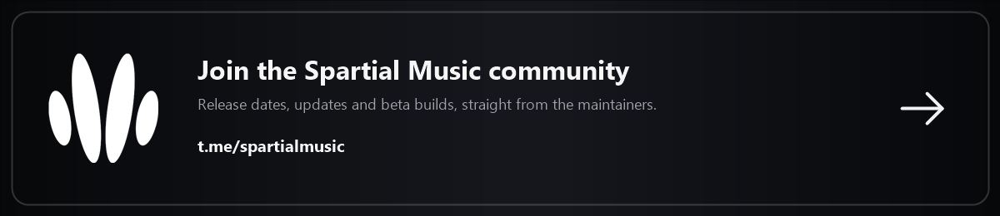
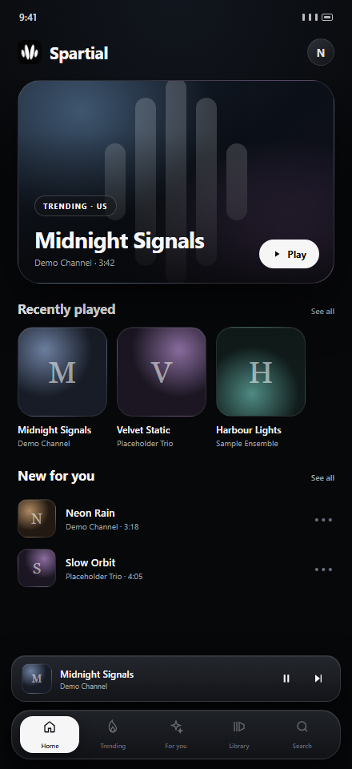
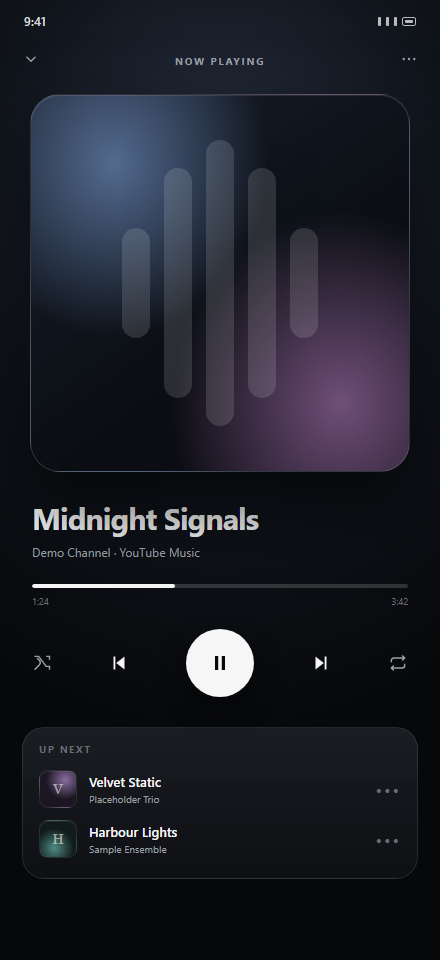
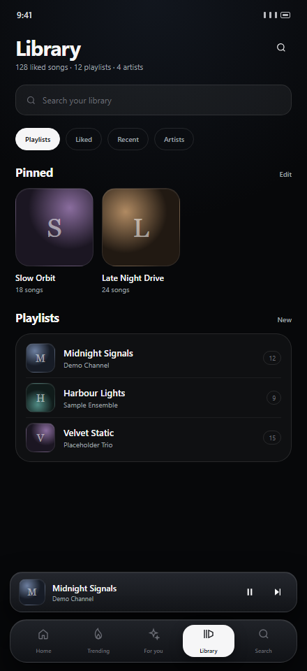

# Spartial Music

<p align="center">
  
</p>

<p align="center">
  <strong>A quiet home for your music.</strong><br>
  An open-source Android player with a near-black, glass-first interface.
</p>

<p align="center">
  <a href="https://t.me/spartialmusic">
    
  </a>
</p>

<p align="center">
  <a href="https://t.me/spartialmusic"><strong>Join the Telegram community →</strong></a><br>
  Release dates, updates and beta builds, straight from the maintainers.
</p>

<p align="center">
  
  
  
</p>

---

## What it is

Spartial Music is a dark-only Android music player built with Kotlin, Jetpack
Compose Material 3, Media3, Room and Hilt. It keeps your likes, playlists,
history and settings on the device, and puts every provider of music behind one
`MusicSource` interface.

- **Local library** — reads audio already on your device through MediaStore.
- **YouTube Music** — the default source, built on the unofficial InnerTube
  client. It is outside the YouTube API Services Terms and can break whenever
  YouTube changes its private endpoints. Read the warning in
  [YOUTUBE.md](YOUTUBE.md) first.
- **Official YouTube mode** — the YouTube Data API v3 provider and the official
  embedded player remain in the codebase. No downloads, no background audio for
  these tracks. See [YOUTUBE.md](YOUTUBE.md).
- **Jamendo** — Creative Commons streaming, credited per track.

There is no account, no sync, no analytics and no advertising. Optional sign-in
only exists so the app can read your own YouTube Music library and push likes;
the session stays on the device. See [PRIVACY.md](PRIVACY.md).

> **YouTube policy:** Spartial Music never downloads, caches or re-encodes
> YouTube media, never skips ads, and never bundles a PoToken or attestation
> bypass. The unofficial source is not endorsed by YouTube and is not covered by
> the YouTube API Services Terms. Spartial Music is not affiliated with YouTube,
> Google or any streaming service.

## Screenshots

<p align="center">
  
  
  
</p>

<p align="center"><sub>Design previews of the current interface. Device screenshots are captured from a real build before each store release.</sub></p>

## The interface

The redesign is built around five floating tabs and one persistent mini player:

| Tab | What it does |
| --- | --- |
| **Home** | Full-bleed hero, recently played, continue playing and provider shelves |
| **Trending** | Charts with position numbers, likes and per-source results |
| **Suggestions** | A feed shaped by the current source and your local listening history |
| **Library** | Playlists and pins, liked songs, recents, artists, local search and an all-songs shortcut |
| **Search** | Genre tiles, recent and suggested searches, grouped song/album/artist results with filters |

Other screens: **Now Playing** (controls, synced lyrics and queue modes),
**Playlist**, **Album**, **Artist**, **Songs**, **Stats**, **Settings**,
**Onboarding**, **Diagnostics** and the labelled **Sessions** UI stub.

Every screen has loading, empty and error states; the app uses 44 dp minimum
touch targets, content descriptions, dynamic type and responsive layouts. The
mini player sits above the tab bar everywhere except the full player. The tab bar
only appears on the five tab roots.

## Design system

- Near-black `#07080A` stage, layered glass surfaces, hairline borders.
- White accent (`#F1F2F4`) with artwork-derived tints on Now Playing, Playlist,
  Album and Artist screens.
- Rounded 20–30 dp cards, generous gutters, one shared spacing/radius/motion token
  set in `ui/theme/Tokens.kt`.
- Dark only. Glass is a gradient film plus border, not `Modifier.blur`, so it
  stays readable on API 26.
- Placeholder artwork is generated procedurally; the demo catalogue is fictional.

## Features

- [x] Five-tab floating navigation and a persistent mini player
- [x] Home hero, recents, continue playing and provider shelves
- [x] Now Playing with controls, lyrics and queue modes
- [x] Artwork-tinted backgrounds with local palette extraction
- [x] Search genres, filters and grouped results
- [x] Playlists, pins, likes, recents, artists and local library search
- [x] Queue reorder, sleep timer, playback speed and skip-silence
- [x] Media3/ExoPlayer playback through a `MediaSessionService`
- [x] Official YouTube IFrame playback with a visible player
- [x] Room-backed likes, playlists, history and provider cache
- [x] Synced `.lrc` lyrics with configurable providers
- [x] Crash reports written locally, never uploaded
- [x] Optional Cast support in the `gms` flavour

## Architecture

```
app/src/main/java/app/nodes
├── core
│   ├── data          SettingsRepository, LibraryRepository, RemoteCache, QuotaTracker
│   ├── data/db       Room entities, DAOs, database
│   ├── model         Track, Playlist, HomeFeed, PlaybackHandle, SourceResult
│   ├── source        MusicSource interface + SourceRegistry + demo catalogue
│   │   ├── local     MediaStore
│   │   ├── jamendo   Creative Commons streaming
│   │   ├── youtube   Data API v3 + optional OAuth
│   │   └── youtubemusic  InnerTube client (default source)
│   └── util
├── playback          PlaybackService (Media3), PlaybackController, PlayerUiState
├── ui
│   ├── components    FloatingTabBar, MiniPlayer, SongRow, Cards, HomeHero, …
│   ├── navigation    Routes, NodesApp
│   ├── screens       home, trending, suggestions, library, search, songs,
│   │                 player, playlist, collection, settings, stats, sessions
│   └── theme         Color, Tokens, Type, Theme, ArtworkTint
└── di                Hilt modules
```

Every provider implements one interface:

```kotlin
interface MusicSource {
    val id: SourceId
    suspend fun availability(): SourceAvailability
    suspend fun search(query: String, limit: Int = 25): SourceResult<List<Track>>
    suspend fun getHome(): SourceResult<HomeFeed>
    suspend fun getTrending(limit: Int = 25): SourceResult<List<Track>>
    suspend fun getPlaylist(playlistId: String): SourceResult<PlaylistDetail>
    suspend fun play(track: Track): SourceResult<PlaybackHandle>
}
```

`play()` returns either `PlaybackHandle.Stream(url)` (local files, CC audio) or
`PlaybackHandle.EmbeddedVideo(videoId)` (official YouTube). The player routes
accordingly: ExoPlayer for streams, the official embedded player for YouTube.

## Build

Requirements:

- JDK 17+ (CI uses 17)
- Android SDK with `compileSdk 37` and `build-tools 37.0.0`
- Gradle 9.6.1 (wrapper included)

```bash
git clone https://github.com/NullTrigger/Spartial-Music.git
cd Spartial-Music
cp local.properties.example local.properties   # add your SDK path + keys
./gradlew :app:assembleDebug                    # gms and foss debug APKs
./gradlew :app:testGmsDebugUnitTest :app:testFossDebugUnitTest
./gradlew :app:lintGmsDebug                     # lintFossDebug for the other flavour
```

Windows: `.\gradlew.bat`. More detail in [BUILDING.md](BUILDING.md).

### Keys

Nothing secret is committed. `app/build.gradle.kts` reads, in order,
`local.properties` then environment variables:

| Key | Needed for |
| --- | --- |
| `YOUTUBE_API_KEY` | Official YouTube search, Home and Trending |
| `YOUTUBE_OAUTH_CLIENT_ID` | Optional Google Sign-In |
| `JAMENDO_CLIENT_ID` | Creative Commons streaming |

Without keys the app still runs: Home shows the placeholder catalogue, the local
source works if you grant audio permission, and Settings explains what is
missing. The default InnerTube source does not need an API key.

## Privacy

No accounts, no analytics, no advertising and no tracking. Library data never
leaves the device. Network requests only happen when you browse or play from a
provider. Full detail: [PRIVACY.md](PRIVACY.md).

## Credits and prior art

Spartial Music is a clean-room implementation. No source file from another music
player is copied into this repository. The InnerTube client was written for this
project; its protocol details and a few product ideas were learned from these
GPL-3.0 projects, and they deserve the credit:

| Project | Licence | What we learned |
| --- | --- | --- |
| [Glossy](https://github.com/izybro110-gif/Glossy) | GPL-3.0 | InnerTube request shape, WebView sign-in study (not copied, not used) |
| [Metrolist](https://github.com/mostafaalagamy/Metrolist) | GPL-3.0 | InnerTube protocol reference |
| InnerTune / OuterTune | GPL-3.0 | InnerTube protocol reference |

The player stands on the Android open-source stack:

- **AndroidX / Jetpack Compose / Material 3** — UI and lifecycle.
- **AndroidX Media3** — playback, media session and Cast.
- **Room** — local library database.
- **Hilt / Dagger** — dependency injection.
- **Coil** — image loading and local palette extraction.
- **Retrofit, OkHttp, kotlinx.serialization, kotlinx.coroutines** — networking and
  async work.
- **Android YouTube Player** — the official embedded player wrapper.

The full dependency list, versions and licences are in
[THIRD_PARTY_LICENSES.md](THIRD_PARTY_LICENSES.md). App code is GPL-3.0-or-later;
see [LICENSE](LICENSE) and [NOTICE.md](NOTICE.md).

### Content and takedowns

No album art, artist names, lyrics, audio or third-party logos are bundled.
Cover art comes from the provider or is generated locally, and
`DemoCatalog.kt` is fictional. If you believe something in this repository
infringes your rights, open an issue or contact the maintainer — we will remove
it promptly. See [SECURITY.md](SECURITY.md) for the contact route.

## Contributing

See [CONTRIBUTING.md](CONTRIBUTING.md) and
[CODE_OF_CONDUCT.md](CODE_OF_CONDUCT.md). Security reports:
[SECURITY.md](SECURITY.md). Data handling: [PRIVACY.md](PRIVACY.md).

## Licence

GPL-3.0-or-later. You are free to use, study, share and modify the app; forks
must stay open under the same licence and keep the copyright notices.

**Not affiliated with, funded, authorised or endorsed by YouTube, Google LLC,
Jamendo or any streaming service.** "YouTube" is a trademark of Google LLC. All
third-party content remains the property of its owners and is used only through
the providers' public APIs and licences.
